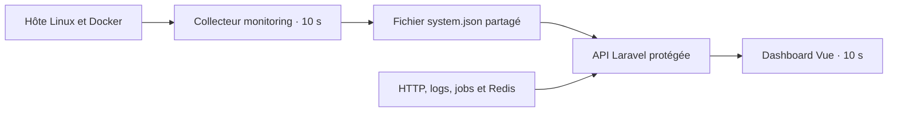

# Monitoring Serveur — HEROES-CRM

Ce guide explique le fonctionnement du dashboard, son activation en production et les contrôles à effectuer lorsque certaines métriques sont indisponibles.

Le dashboard est accessible dans **Paramètres → Monitoring Serveur** (réservé au Super Admin), à l’adresse `/server-monitoring`. Le menu, la route Vue et l’API `GET /api/server-monitoring` sont réservés aux utilisateurs dont le rôle est `super_admin`.

**Aucun monitoring MySQL ou de base de données n’est intégré. Aucune migration SQL n’est nécessaire pour cette fonctionnalité.**

## 1. Comment ça marche



Deux collectes fonctionnent séparément :

- **Hôte et Docker** : le service Docker `monitoring` exécute `php artisan monitoring:collect --loop`. Il lit les compteurs Linux et l’API Docker, puis publie un relevé dans `storage/app/server-monitoring/system.json`.
- **Application** : Laravel enregistre les agrégats HTTP et les événements de jobs échoués. L’API lit aussi les logs configurés et interroge Redis avec des délais courts. Les diagnostics Redis et Laravel sont partagés entre les administrateurs via un cache local de dix secondes.

Le navigateur interroge l’API toutes les **10 secondes**, sans recharger la page. Les requêtes ne se chevauchent pas. Le rafraîchissement se met en pause lorsque l’onglet est masqué et s’arrête lorsque le composant est fermé.

Le collecteur système est indépendant de PHP-FPM et du scheduler Laravel. Les métriques HTTP, Redis et Laravel peuvent donc fonctionner même si le collecteur hôte/Docker est arrêté.

## 2. Ce que les chiffres représentent

| Section | Source et périmètre |
| --- | --- |
| CPU hôte | Compteurs Linux de l’hôte : utilisation, cœurs logiques, charge à 1/5/15 minutes et uptime. |
| RAM hôte | `MemTotal` et `MemAvailable`. Utilisée = totale − disponible. |
| Disque hôte | Système de fichiers racine de l’hôte. Les autres volumes ne sont pas additionnés. |
| Réseau hôte | Débits entrants/sortants calculés entre deux relevés. Les interfaces internes Docker sont exclues pour limiter le double comptage. |
| Capacité réseau | Vitesse annoncée par l’interface, si disponible. Ce chiffre ne mesure pas le débit maximal de la connexion Internet. |
| Docker | États des conteneurs du projet Compose CRM et CPU/RAM des conteneurs actifs. Les moteurs de bases connus sont exclus avant la lecture de leurs statistiques. |
| HTTP | Requêtes traitées par Laravel, hors API de monitoring. Les ressources statiques et les erreurs survenues avant PHP ne sont pas comptées. |
| Temps de réponse | Durée mesurée côté Laravel. Le P95 est une borne haute approximative issue d’un histogramme. |
| Latence navigateur | Aller-retour entre le navigateur et l’API de monitoring. |
| Redis | Disponibilité, mémoire consommée, limite configurée et latence du PING. |
| Logs Laravel | Jusqu’à 50 entrées issues de la fin des fichiers locaux des canaux actifs. Messages et contextes sont masqués ; les classes d’exception sont conservées. |
| Jobs échoués | Événements `JobFailed` observés pendant les dernières 24 h, depuis l’initialisation du suivi. Les anciens enregistrements de la table `failed_jobs` ne sont pas lus. |

Les ressources **hôte** et **conteneurs** sont distinctes. Pour Docker, **100 % de CPU correspond à un cœur logique** : un conteneur peut dépasser 100 % sur plusieurs cœurs.

Les premières mesures CPU et réseau nécessitent deux échantillons. Une valeur `—` signifie « indisponible » ou « en attente », jamais une valeur simulée. Un relevé système datant de plus de **40 secondes** n’est plus affiché comme actuel.

## 3. Installation en production

Les commandes suivantes supposent l’architecture du dépôt : serveur Linux, Docker Compose, conteneur PHP nommé `heroescrm`, image `heroescrm:latest` déjà disponible et code partagé dans `/var/www`.

Exécuter les commandes depuis le dossier HEROES-CRM sur le serveur, dans la même session shell pour conserver la variable `MONITORING_PROJECT`.

Si la production utilise déjà d’autres fichiers de surcharge Compose, les conserver dans les commandes en y ajoutant `docker-compose.monitoring.yml`. Les exemples ci-dessous utilisent le fichier principal et la surcharge de monitoring.

### Étape A — Déployer le code et les assets

Déployer l’ensemble des modifications du monitoring, notamment :

- le backend et l’enregistrement du provider/middleware ;
- les composants Vue, le menu et la route ;
- [config/server-monitoring.php](config/server-monitoring.php) ;
- [docker-compose.monitoring.yml](docker-compose.monitoring.yml).

Sur la machine utilisée pour compiler les assets, avec les dépendances Node installées :

```bash
npm run production
```

Déployer tous les assets générés : `public/js`, y compris le nouveau chunk du dashboard, `public/css` s’il a changé, ainsi que `public/mix-manifest.json` avec le backend correspondant.

### Étape B — Identifier le projet Compose existant

```bash
MONITORING_PROJECT=$(docker inspect heroescrm --format '{{index .Config.Labels "com.docker.compose.project"}}')
echo "$MONITORING_PROJECT"
```

La valeur doit être le nom du projet Compose du CRM existant. Si la sortie est vide, vérifier le nom du conteneur et la méthode de déploiement avant de continuer.

Dans le `.env` de production, définir ce même nom. Par exemple, **si la commande affiche `heroes-crm`** :

```dotenv
MONITORING_DOCKER_PROJECT=heroes-crm
SERVER_MONITORING_ENABLED=true
```

Le nom de projet est important : Docker utilise son label `com.docker.compose.project` pour sélectionner les conteneurs du CRM et éviter de parcourir les anciens conteneurs d’autres applications à chaque collecte.

**Configurer le `.env` avant de reconstruire le cache Laravel.** Le cache de configuration est partagé avec le collecteur : les variables de son conteneur ne remplacent pas les valeurs déjà enregistrées dans ce cache.

### Étape C — Préparer le répertoire partagé

```bash
docker exec --user root heroescrm sh -c 'mkdir -p /var/www/storage/app/server-monitoring && chown www-data:www-data /var/www/storage/app/server-monitoring && chmod 0770 /var/www/storage/app/server-monitoring'
```

Le processus PHP utilise `www-data` (UID/GID 33 dans l’image). Le collecteur utilise le groupe 33 pour publier des relevés lisibles par PHP. Seul ce répertoire de monitoring est concerné par cette commande.

### Étape D — Actualiser Laravel

Après déploiement du code et mise à jour du `.env` :

```bash
docker exec --user www-data heroescrm php artisan config:cache
docker exec --user www-data heroescrm php artisan route:clear
```

Si votre procédure de déploiement reconstruit habituellement le cache des routes, l’appliquer ensuite avec les nouvelles routes.

Pour que les workers persistants chargent le suivi des jobs échoués après leur travail en cours :

```bash
docker exec --user www-data heroescrm php artisan queue:restart
```

La relance effective des workers dépend du gestionnaire de processus déjà configuré pour le CRM.

### Étape E — Démarrer le collecteur

```bash
docker compose -p "$MONITORING_PROJECT" \
  -f docker-compose.yml \
  -f docker-compose.monitoring.yml \
  up -d --no-deps monitoring
```

Cette commande démarre ou recrée **uniquement le collecteur**, sans redémarrer les services CRM. Le service utilise `restart: unless-stopped` et reprend avec Docker, sauf s’il a été arrêté explicitement.

Pour un environnement utilisant la surcharge de développement, ajouter `-f docker-compose.dev.yml` entre les deux fichiers de cette commande.

### Étape F — Vérifier

```bash
docker compose -p "$MONITORING_PROJECT" \
  -f docker-compose.yml \
  -f docker-compose.monitoring.yml \
  ps monitoring
```

Consulter les éventuelles erreurs du collecteur :

```bash
docker compose -p "$MONITORING_PROJECT" \
  -f docker-compose.yml \
  -f docker-compose.monitoring.yml \
  logs --tail=50 monitoring
```

L’absence de nouvelle ligne dans ces logs est normale lorsque la collecte fonctionne : le mode continu n’affiche pas chaque relevé réussi.

Attendre environ **20 secondes**, puis ouvrir **Paramètres → Monitoring Serveur** avec un compte Super Admin de cet environnement. Vérifier que l’heure du relevé système avance et que les sections hôte et Docker sont disponibles.

## 4. Configuration et alertes

La configuration se trouve dans [config/server-monitoring.php](config/server-monitoring.php).

| Paramètre | Valeur par défaut | Utilisation |
| --- | --- | --- |
| `interval` | 10 s | Fréquence de collecte système. Le frontend interroge actuellement l’API toutes les 10 s. |
| `stale_after` | 40 s | Âge maximal d’un relevé système considéré comme actuel. |
| `http_window` | 60 s | Fenêtre des agrégats HTTP, par tranches de 5 s. |
| `docker_project` | Variable `MONITORING_DOCKER_PROJECT` | Filtre sur le projet Compose. Une valeur vide autorise un inventaire global des conteneurs éligibles. |
| `docker_max_containers` | 30 | Limite de conteneurs détaillés ; les actifs passent en priorité. Un inventaire tronqué est signalé. |
| `docker_timeout` | 2 s | Délai individuel maximal d’un appel Docker. |
| `docker_budget_seconds` | 3 s | Budget global de collecte Docker. |
| `thresholds.cpu` | 85 % | Seuil d’alerte CPU hôte. |
| `thresholds.memory` | 90 % | Seuil d’alerte RAM hôte. |
| `thresholds.disk` | 90 % | Seuil d’alerte disque hôte. |
| `expected_containers` | `heroescrm`, `nginx`, `redis-heroes`, `supervisor` | Services permanents attendus. Adapter cette liste si leurs noms diffèrent en production. |

Les alertes couvrent aussi les erreurs HTTP 5xx récentes, les erreurs présentes dans les entrées Laravel consultables des cinq dernières minutes, les jobs échoués observés et les sources indisponibles.

Les arrêts des services attendus, même avec un code de sortie 0, sont signalés. Les conteneurs ponctuels ou anciens qui ne sont pas attendus restent consultables sans déclencher cette alerte d’arrêt. Les états `restarting`, `dead` ou `unhealthy` restent signalés.

`SERVER_MONITORING_ENABLED=false` désactive **la télémétrie HTTP et des jobs uniquement**. Cette variable n’arrête pas le collecteur hôte/Docker et ne désactive pas Redis ou la lecture des logs.

Après modification de la configuration, reconstruire son cache puis redémarrer le seul collecteur pour qu’il recharge les paramètres :

```bash
docker exec --user www-data heroescrm php artisan config:cache

docker compose -p "$MONITORING_PROJECT" \
  -f docker-compose.yml \
  -f docker-compose.monitoring.yml \
  restart monitoring
```

Si le fichier Compose ou les variables d’environnement du service changent, utiliser plutôt `up -d --no-deps monitoring` pour recréer le conteneur avec sa nouvelle configuration.

Après une modification de l’activation de la télémétrie ou du suivi des jobs, les workers persistants doivent aussi recharger leur configuration :

```bash
docker exec --user www-data heroescrm php artisan queue:restart
```

## 5. Exploitation

Pour les déploiements suivants, conserver le fichier `docker-compose.monitoring.yml` dans les commandes Compose de ce projet. Après une mise à jour du code du collecteur, redémarrer ce service pour charger les nouvelles classes PHP.

Pour l’arrêter explicitement :

```bash
docker compose -p "$MONITORING_PROJECT" \
  -f docker-compose.yml \
  -f docker-compose.monitoring.yml \
  stop monitoring
```

Les ressources système seront alors signalées comme périmées après le délai configuré. Le CRM continue de fonctionner.

Les fichiers sous `storage/app/server-monitoring` contiennent les relevés système, les compteurs privés et les agrégats locaux. Ils ne constituent pas un historique longue durée : les graphiques affichent jusqu’à cinq minutes de points conservés pendant l’ouverture de la page.

Le collecteur n’expose aucun port et n’a pas de réseau. Ses montages hôte et son socket Docker sont réservés à ce service. **Le socket Docker reste une capacité sensible : son montage en lecture seule ne limite pas les commandes autorisées par l’API.** Le code du collecteur utilise uniquement des requêtes GET d’inventaire et de statistiques.

## 6. Dépannage

| Symptôme | Vérifications |
| --- | --- |
| « Collecteur non démarré ou relevé inaccessible » | Vérifier `ps monitoring`, les logs du service, l’existence de `storage/app/server-monitoring/system.json` et ses permissions pour `www-data`. |
| « Relevé périmé » | Vérifier que le collecteur reste actif et que le fichier `system.json` est actualisé. Contrôler l’espace disque et les erreurs d’écriture. |
| Hôte indisponible, application disponible | Vérifier les montages `/proc`, `/sys` et `/` du service monitoring. Sans ces montages, un collecteur dans Docker n’annonce pas les ressources de son conteneur comme celles de l’hôte. |
| Docker seul indisponible | Vérifier le montage du socket, les délais, le moteur Docker et le nom de projet configuré. Pour un socket rootless/personnalisé, adapter le montage et `MONITORING_DOCKER_SOCKET`. |
| Docker vide ou services attendus absents | Comparer `MONITORING_DOCKER_PROJECT` au label réel du CRM. Recréer le cache Laravel après correction, puis redémarrer le collecteur. |
| CPU Docker temporairement inconnu | Deux compteurs valides sont nécessaires. Après une collecte échouée, la base privée est conservée jusqu’à 60 s pour calculer un vrai delta à la reprise ; aucune ancienne mesure n’est affichée pendant l’échec. |
| « Un collecteur est déjà actif » | Un verrou empêche deux boucles de tourner simultanément. Ne pas lancer une seconde commande `monitoring:collect --loop` lorsque le service fonctionne déjà. |
| Redis indisponible | Vérifier la configuration Redis de Laravel et la disponibilité du service. Une panne Redis ne bloque pas l’affichage des autres sections. |
| Jobs échoués à 0 | Vérifier la date de début du suivi, son activation et le chargement du nouveau code dans les workers. Le compteur n’inclut pas l’historique SQL antérieur. |
| Logs indisponibles | Vérifier le canal Laravel actif et ses permissions. Seuls les fichiers locaux des canaux `single`/`daily` configurés sont lus, pas les destinations distantes. |
| Cartes visibles, graphiques indisponibles | Vérifier dans le navigateur le chargement de Chart.js et la politique CSP. Le chargeur existant du CRM utilise `unpkg.com`. |
| Menu absent ou accès refusé | Vérifier les assets déployés, la session et le rôle `super_admin` du compte dans cet environnement. |
| Erreur de permission pendant les commandes Artisan | Vérifier les droits de `bootstrap/cache` et des répertoires Laravel concernés. Exécuter les commandes applicatives avec l’utilisateur PHP selon la procédure du serveur. |

Les requêtes `/_debugbar/open` visibles en développement sont de vraies requêtes Laravel ; elles peuvent donc apparaître dans les endpoints les plus sollicités.

Une erreur affichée dans les logs du dashboard provient des logs de l’application. Il faut examiner sa cause séparément ; le dashboard ne la corrige pas. Par exemple, un fichier `GeoLite2-City.mmdb` absent concerne la géolocalisation MaxMind.

## 7. Fichiers et vérifications techniques

| Fichier | Rôle |
| --- | --- |
| [docker-compose.monitoring.yml](docker-compose.monitoring.yml) | Service de collecte, montages et limites de ressources. |
| [config/server-monitoring.php](config/server-monitoring.php) | Paramètres, filtres et seuils. |
| [CollectServerMonitoring.php](app/Console/Commands/CollectServerMonitoring.php) | Commande Artisan continue et verrou d’exécution. |
| [SystemCollector.php](app/Services/Monitoring/SystemCollector.php) | Lecture des ressources hôte et Docker, publication atomique des relevés. |
| [ServerMonitoring.php](app/Services/Monitoring/ServerMonitoring.php) | Assemblage des sources, cache des diagnostics et alertes. |
| [RecordServerMonitoringRequest.php](app/Http/Middleware/RecordServerMonitoringRequest.php) | Agrégats HTTP après traitement des requêtes. |
| [ServerMonitoringServiceProvider.php](app/Providers/ServerMonitoringServiceProvider.php) | Enregistrement du stockage de télémétrie et écoute des jobs échoués. |
| [ServerMonitoringController.php](app/Http/Controllers/API/ServerMonitoringController.php) | Contrôle Super Admin et réponse API privée. |
| [Dashboard.vue](resources/js/components/server-monitoring/Dashboard.vue) | Interface, polling et graphiques. |

Tests ciblés et validation de la configuration, à utiliser pendant le développement ou la recette :

```bash
docker exec heroescrm vendor/bin/phpunit tests/Unit/ServerMonitoringSystemCollectorTest.php
docker exec heroescrm vendor/bin/phpunit tests/Unit/Monitoring
docker exec heroescrm vendor/bin/phpunit tests/Feature/ServerMonitoringTest.php
node tests/frontend/server-monitoring.test.cjs

docker compose -p "$MONITORING_PROJECT" \
  -f docker-compose.yml \
  -f docker-compose.monitoring.yml \
  config --quiet
```

La validation Compose ne démarre aucun service. Le détail des sources de métriques et des limites de collecte est également disponible dans [docs/server-monitoring.md](docs/server-monitoring.md).
